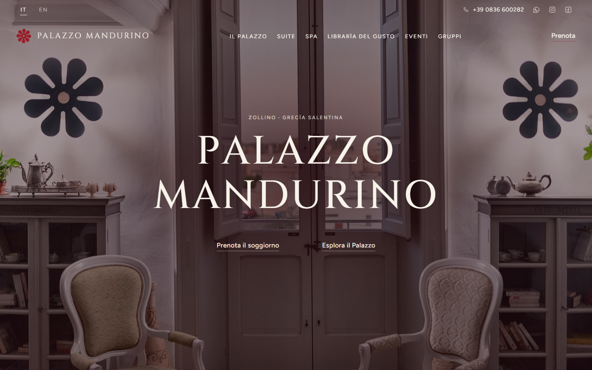
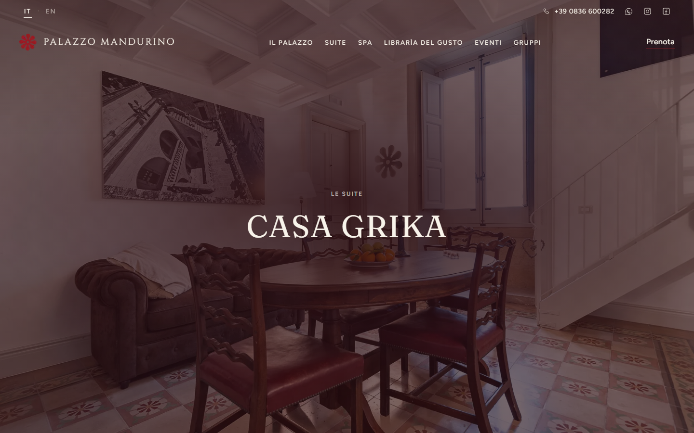
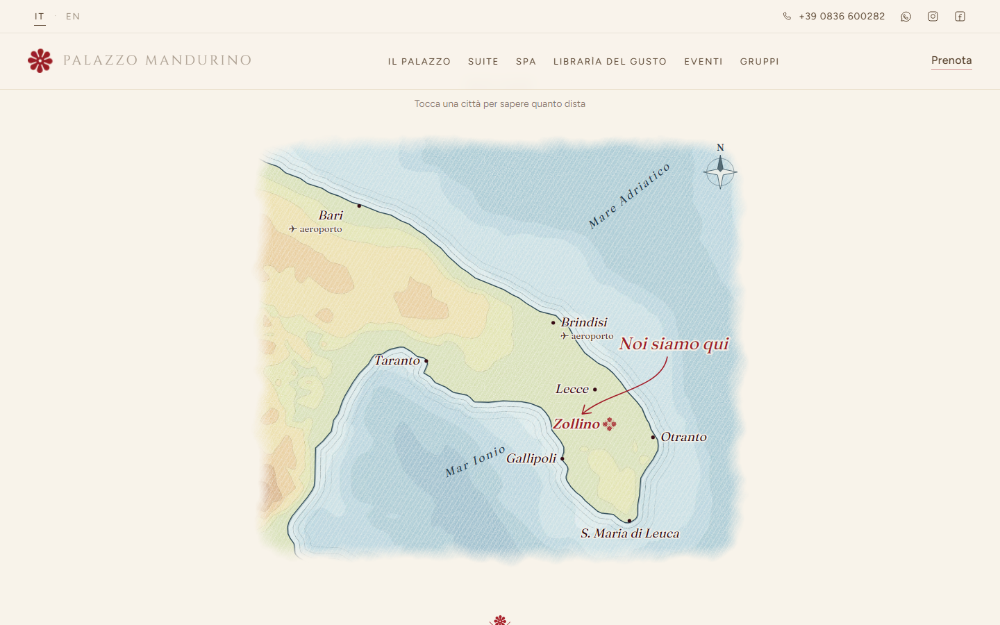
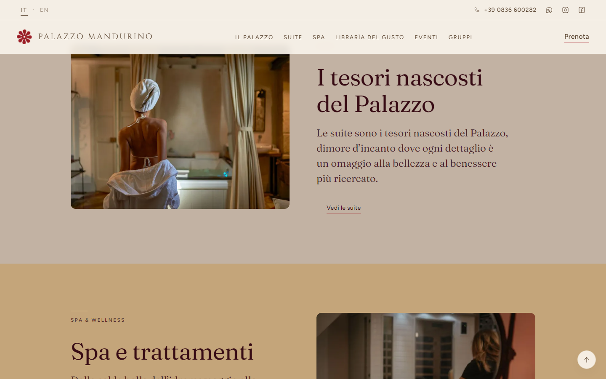
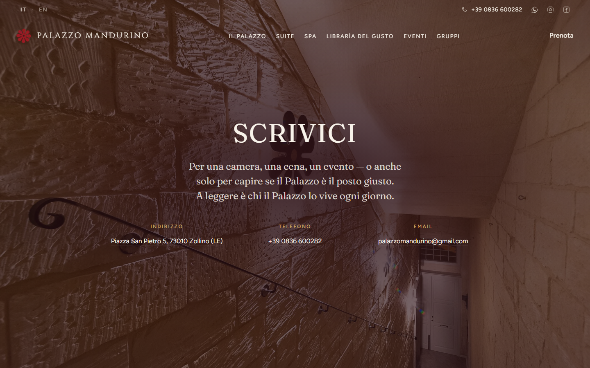
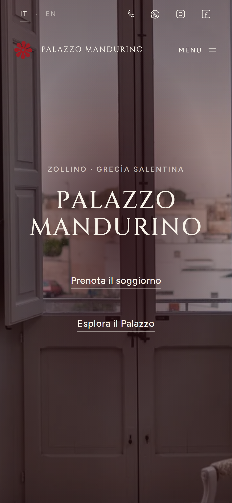
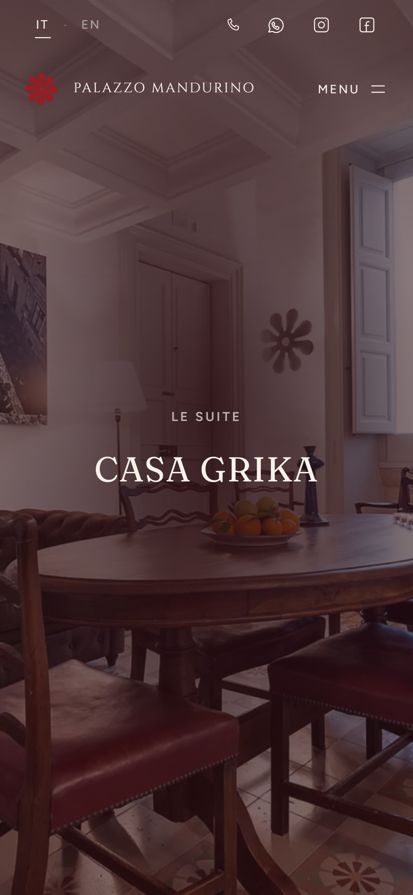

# Palazzo Mandurino — sito web

**Dimora storica con suite, spa e ristorante a Zollino, nel cuore della Grecìa Salentina.**
Sito progettato e sviluppato da zero: design, codice, contenuti bilingue e pannello di
gestione per la proprietà.

🔗 **[Vedi il sito](https://mellifluous-granita-c62e23.netlify.app/)** · in arrivo su `palazzomandurino.it`

  

---

## Il punto di partenza

Il vecchio sito era un WordPress compromesso da spam SEO: pagine nascoste, link estranei,
lento e poco leggibile da telefono. Non si è recuperato nulla del codice — solo i testi,
riletti e riscritti con la proprietà. Il dominio resta lo stesso, quindi i vecchi
indirizzi indicizzati da Google sono stati mappati uno per uno sui nuovi.

## Cosa è stato fatto

| | |
|---|---|
| **Sito bilingue** | Italiano e inglese, una quarantina di pagine, dieci schede suite con la loro storia, servizi e galleria |
| **Pannello per la proprietà** | La proprietà modifica testi, foto, colori e caratteri da sola, dal browser, senza toccare il codice. Ogni modifica passa da una bozza prima di andare online |
| **Velocità** | Sito statico, immagini ridotte e convertite in automatico per ogni schermo, caratteri ospitati in casa |
| **Privacy** | Nessuno script, font o servizio di terze parti: nessun tracciamento, e per questo nessun banner dei cookie |
| **Accessibilità** | Contrasti misurati secondo WCAG AA, testi alternativi su ogni foto, animazioni che si spengono per chi ha chiesto meno movimento |
| **SEO** | Dati strutturati (hotel, camere, ristorante), `hreflang` tra le lingue, sitemap, 38 redirect 301 dal vecchio sito per non perdere il posizionamento |
| **Mappa** | Carta del Salento disegnata dal codice, con il rilievo vero del terreno e le distanze dalle città vicine |

  
  

  
  

  
  &nbsp;&nbsp;
  

## Come è costruito

- **[Astro](https://astro.build)** — sito statico, componenti riutilizzabili, React solo dove serve interazione
- **Tailwind CSS 4** — un design system con palette, caratteri e misure in un solo file, letto sia dal sito sia dal pannello
- **Decap CMS** — il pannello di gestione, con flusso a bozze e approvazione
- **Netlify** — pubblicazione automatica a ogni modifica approvata
- **Controlli automatici** prima di ogni pubblicazione: link interrotti, pagine mancanti,
  testi rimasti in una lingua sola, contrasti dei colori, e una prova che muove ogni
  campo del pannello per assicurarsi che nessuna modifica possa rompere il sito

## Crediti

Committente: Palazzo Mandurino, Zollino (LE). Fotografie: FOTOgrafica.
Il codice sorgente è privato; questo repository raccoglie la presentazione del progetto.

---

**EN** — Website for Palazzo Mandurino, a historic guesthouse with suites, spa and restaurant
in Salento, southern Italy. Designed and built from scratch: bilingual Italian/English
static site (Astro, Tailwind), a self-service CMS for the owners, no third-party scripts,
WCAG AA contrast, structured data and 301 redirects from the old WordPress site.
